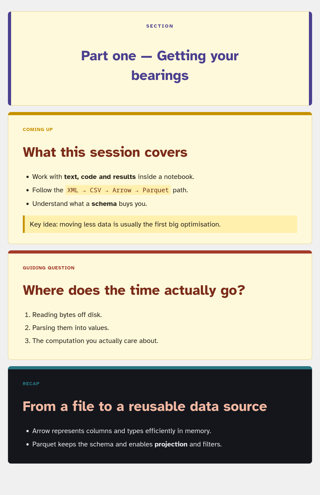

# jupyter-notebook-slide

Slides *inside* your notebook. `%%slide` turns a cell of very small Markdown
into a self-contained HTML card — a "coming up" slide, a recap, a guiding
question or a section divider — so a teaching notebook can show structure
without leaving the notebook.

No JavaScript, no frontend extension, no nbconvert step: the output is a single
`<div>` with inline styles, so it renders identically in **Jupyter**, **Google
Colab**, **VS Code** and in exported HTML.



```python
%load_ext notebook_slide
```

```python
%%slide preview
# What this session covers
- Work with **text, code and results** inside a notebook.
- Follow the `XML → CSV → Arrow → Parquet` path without hiding the conversions.
- Understand what a **schema** buys you.

> Key idea: moving less data is usually the first big optimisation.
```

## Install

```bash
pip install "jupyter-notebook-slide @ git+https://github.com/dsevilla/jupyter-notebook-slide.git"
```

or, with [uv](https://docs.astral.sh/uv/):

```bash
uv add "jupyter-notebook-slide @ git+https://github.com/dsevilla/jupyter-notebook-slide.git"
```

In a notebook (Colab included), install and load in one go:

```python
%pip install -q "jupyter-notebook-slide @ git+https://github.com/dsevilla/jupyter-notebook-slide.git"
%load_ext notebook_slide
```

Pin a release with `@v0.1.3` at the end of the URL.

## Slide types

| Type | Badge | Layout | Use it for |
| --- | --- | --- | --- |
| `preview` (default) | Coming up | left-aligned | what the next stretch of notebook will do |
| `summary` | Recap | left-aligned | what the reader should take away |
| `question` | Guiding question | left-aligned | the question the next cells answer |
| `title` | — | centred headings, left-aligned body, framed both sides | a section break between parts |

```python
%%slide title
# Part two — Columnar storage
```

`%slide_types` lists the registered types, their colours and the available
themes.

## The Markdown dialect

Deliberately tiny, so a slide always fits on screen:

| Syntax | Result |
| --- | --- |
| `# Heading` | slide heading |
| `## Subheading` | section heading inside the slide |
| `- item` | bullet list (indent with spaces to nest items) |
| `1. item` | numbered list (indent with spaces to nest items) |
| `> note` | call-out box in the accent colour |
| `**bold**`, `*italic*`, `***both***` | emphasis |
| `` `code` `` | inline code chip |
| `[text](https://…)` | link (only `http(s):`, `mailto:` and relative URLs) |

Everything else becomes a paragraph, and all text is HTML-escaped, so pasting
`<script>` into a slide is harmless. A blank line ends a list.

Both list styles can be nested or mixed by indenting a child item:

```markdown
- Point 1
  - Subpoint 1.1

1. Point 1
   1. Subpoint 1.1
```

## Colours, fonts and geometry

Everything visual lives in a `Theme`. The defaults are the warm "amber" palette
and the [Atkinson Hyperlegible](https://www.brailleinstitute.org/freefont/)
family (pulled from Google Fonts, with a local fallback stack), but every field
is yours to change.

```python
import notebook_slide as ns

ns.configure(
    accent="#0f766e",
    background="#f7fbfa",
    heading="#0b3b36",
    font_family="'IBM Plex Sans', 'Segoe UI', sans-serif",
    font_url="https://fonts.googleapis.com/css2?family=IBM+Plex+Sans&display=swap",
)
```

Using a font that is already installed on the machine? Drop the web font
entirely:

```python
ns.configure(font_family="'Iosevka Aile', sans-serif", font_url=None)
```

Or from the notebook, without importing anything:

```python
%slide_theme accent=#0f766e font_family="'IBM Plex Sans', sans-serif"
%slide_theme midnight          # a built-in theme: amber (default), slate, midnight
%slide_theme reset             # back to the defaults
```

### Theme fields

| Group | Fields |
| --- | --- |
| Palette | `background`, `foreground`, `border`, `accent`, `heading`, `subheading`, `link`, `code_background`, `code_foreground`, `quote_background` |
| Typography | `font_family`, `font_url`, `font_size`, `line_height`, `heading_font_family`, `heading_font_size`, `subheading_font_size`, `label_font_size` |
| Geometry | `max_width`, `min_height`, `padding`, `margin`, `border_radius`, `accent_bar_width` |

`Theme` is a frozen dataclass, so you can also build one explicitly and keep
several around:

```python
from notebook_slide import Theme

lecture = Theme(accent="#a33a2b", max_width="1100px")
handout = lecture.replace(min_height="0px", font_size="18px")
ns.set_theme(lecture)
```

### Per-slide overrides

Any theme field can be overridden for a single slide, on the magic line or in
the function call — the global theme is left alone:

```python
%%slide summary color=#287681 label="Where we are" background=#f2fbfb
# Recap
- Parquet keeps the schema.
```

## Your own slide types

`register_slide_type` adds a type, or replaces a built-in one — which is also
how you translate the badges:

```python
ns.register_slide_type("demo", "Live demo", "#aa00aa")
ns.register_slide_type("resumen", "Recapitulación", "#287681")
ns.register_slide_type("seccion", "Sección", "#4a3f8f", layout="title")

# Per-type theme overrides are allowed too:
ns.register_slide_type("warning", "Careful", "#b45309", background="#fff7ed")
```

Two layouts exist: `"default"` (left-aligned content) and `"title"` (centred
headings with a left-aligned body, framed as a section divider).

Prefer to write the magic in your own language? Register an alias:

```python
ns.register_alias("diapositiva")
```

```python
%%diapositiva resumen
# Del fichero a una fuente de datos reutilizable
```

## Python API

Useful outside a notebook cell — in a script, a test, or when generating a page:

```python
from notebook_slide import slide, slide_html

slide("# Hi", type="title")  # IPython display object
slide_html("# Hi", type="title")  # plain HTML string
```

| Function | What it does |
| --- | --- |
| `slide(body, type=…, label=…, color=…, **theme_fields)` | render as an IPython `HTML` object |
| `slide_html(...)` | same, as a string |
| `configure(**fields)` | override fields of the current theme |
| `use_theme(name, **overrides)` | switch to a built-in theme |
| `set_theme(theme)` / `current_theme()` | set / read the active `Theme` |
| `register_slide_type(...)` / `unregister_slide_type(name)` | manage slide types |
| `slide_types()` / `get_slide_type(name)` | inspect slide types |
| `register_alias(name)` | add another cell-magic name |
| `reset()` | back to defaults |
| `markdown_to_html(text, theme)` / `format_inline(text, theme)` | the renderer itself |

## Magics

| Magic | Purpose |
| --- | --- |
| `%%slide [type] [key=value …]` | render the cell as a slide |
| `%slide_theme [name] [key=value …]` \| `%slide_theme reset` | change the theme |
| `%slide_types` | list slide types and themes |

## Examples

[`examples/demo.ipynb`](examples/demo.ipynb) shows every slide type, a custom
font, a custom palette and a translated set of badges. Run it with:

```bash
uv run --with jupyterlab jupyter lab examples/demo.ipynb
```

## Development

```bash
uv sync --group dev
uv run pytest
uv run ruff check .
uv run ruff format .
```

Versioning follows [Semantic Versioning](https://semver.org/); see
[CHANGELOG.md](CHANGELOG.md). When the version in `pyproject.toml` changes on
`main`, GitHub Actions builds the package and creates the corresponding GitHub
release and `v<version>` tag automatically.

## License

MIT — see [LICENSE](LICENSE).
